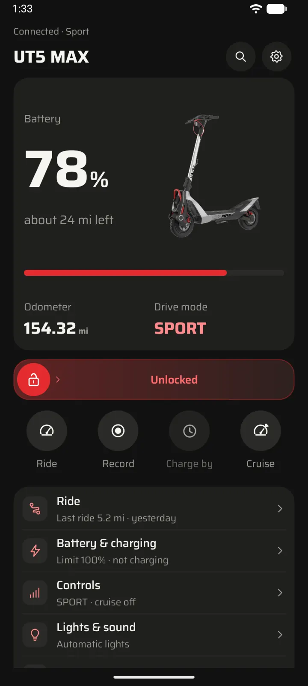
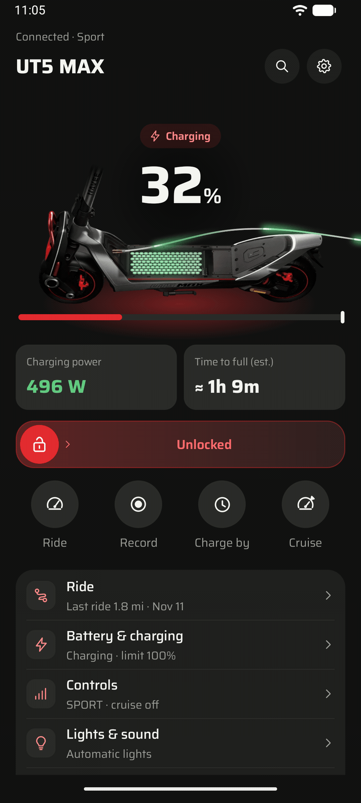
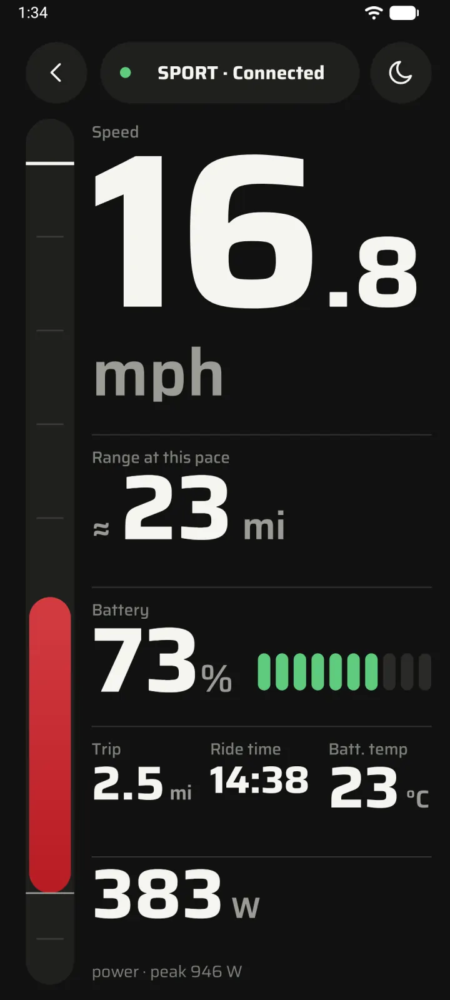
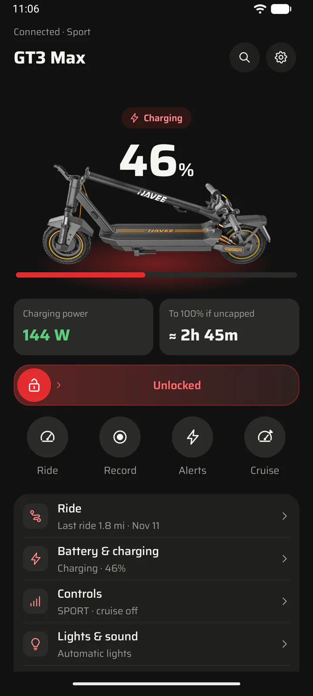
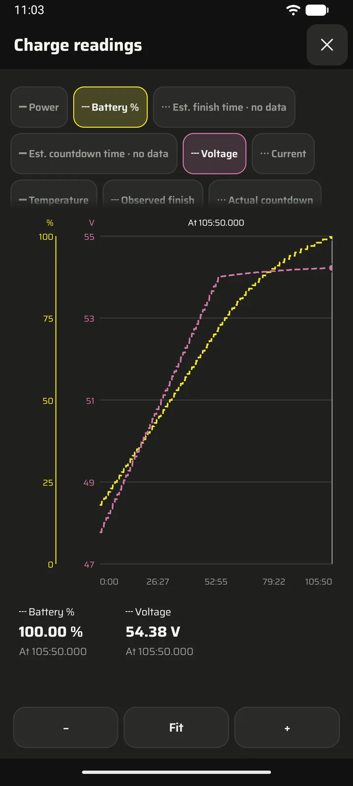
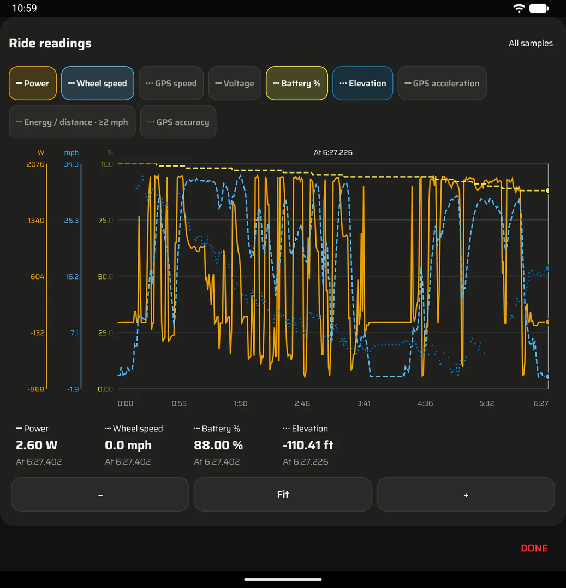
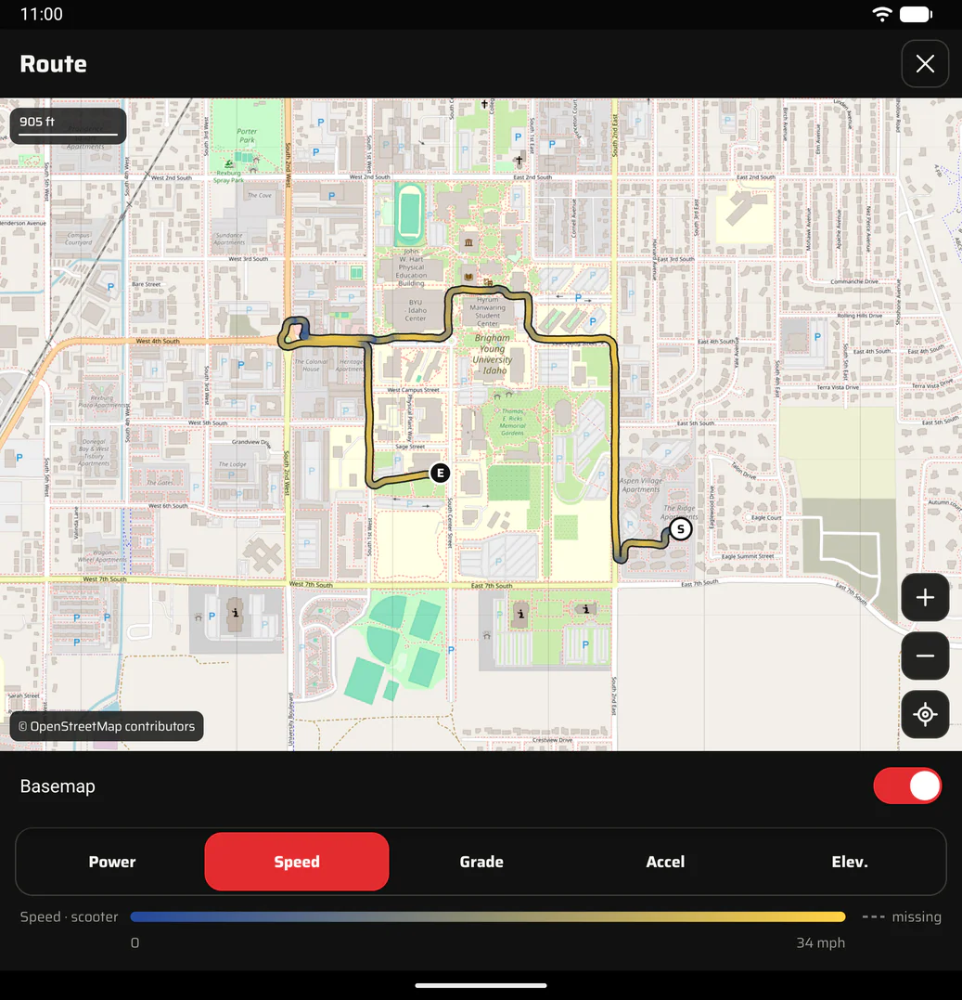
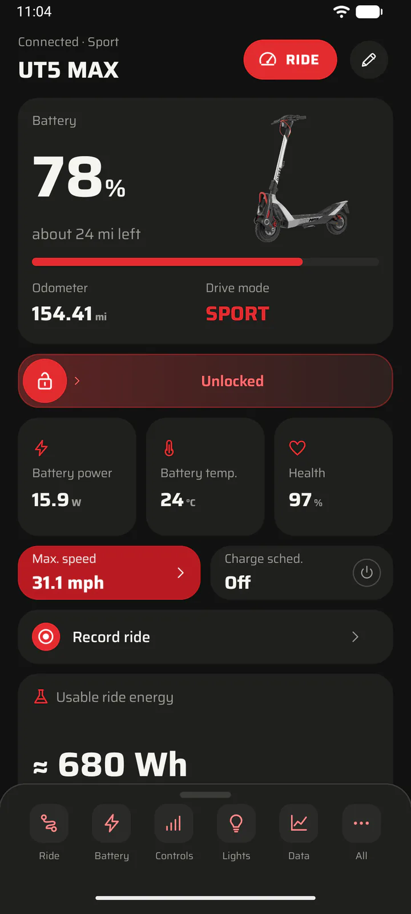
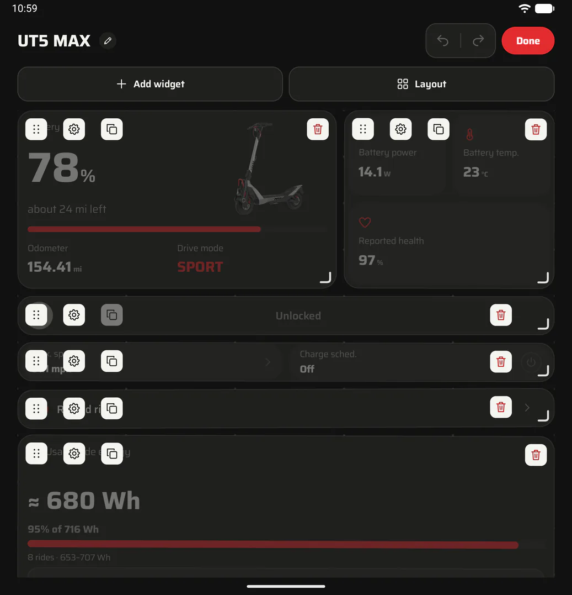
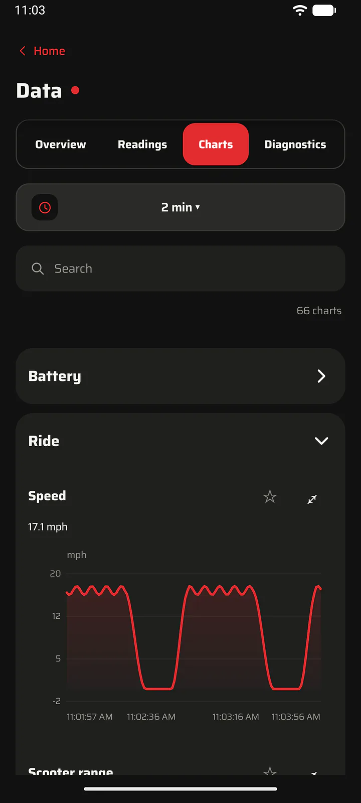

<h1 align="center">⚡ Volt</h1>

<strong>Your scooter. Your connection.</strong>

  <a href="https://github.com/JJRicks/volt/releases/latest"><strong>Download for Android</strong></a>
  &nbsp; · &nbsp;
  <a href="docs/getting-started.md">Setup guide</a>
  &nbsp; · &nbsp;
  <a href="docs/user-guide.md">User guide</a>
  &nbsp; · &nbsp;
  <a href="CHANGELOG.md">What's new</a>

  
  &nbsp;
  
  &nbsp;
  

An Android companion for **NAVEE scooters**. Connect over Bluetooth, control your scooter, make the dashboard yours, and explore your rides and battery data. Everyday use works without a Volt account or server.

> [!NOTE]
> **Independent community project.** Volt is not affiliated with, endorsed by, sponsored by, or supported by NAVEE or its app vendor. Product names identify compatible hardware only.

## Make it yours

| Feature | What you get |
| :--- | :--- |
| 🔒 **Local controls** | Lock/unlock and supported riding, lighting and charging settings, on the short subject pages Home leads to. |
| 🏠 **Home your way** | **Clean**, a fixed Home with four quick actions and charging and last-ride views that come up by themselves, or **Widgets**, a dashboard of movable, resizable widgets with saved layouts for folded and unfolded screens. Search finds any page, setting, reading or ride. |
| 📊 **Live insights** | Searchable readings, charts, favourites and last-seen values. |
| 🗺️ **Ride recordings** | Optional GPS routes, phone sensors, energy readings and complete ride backups. |
| 🛴 **Riding mode** | A full-screen ride view with big speed, range at this pace and power, in three layouts you can edit, with night vision after sunset. |
| 🔋 **Battery insights** | Optional range learned from your rides, charging estimates, a live charging card on the lock screen and experimental usable ride energy. |
| 🔧 **Maintenance** | Distance and time reminders, with a quiet notification when a check is due. |
| 🌐 **Languages** | English, plus Spanish, Portuguese (Portugal), Portuguese (Brazil), Swedish, German, French, Italian, Dutch, Turkish and Polish (all beta, fully translated), with more in progress. |

## A closer look

### Charging

<table>
  <tr>
    <td align="center" valign="top" width="50%">
       
      Charging, on a model shown with a still picture
    </td>
    <td align="center" valign="top" width="50%">
       
      Recorded charges, graphed: the time-to-full estimate against the real finish
    </td>
  </tr>
</table>

### Rides

<table>
  <tr>
    <td align="center" valign="top" width="50%">
       
      Ride graphs on an unfolded screen: wheel speed, power, elevation and battery %
    </td>
    <td align="center" valign="top" width="50%">
       
      The route map, expanded and colored by speed
    </td>
  </tr>
</table>

### Widgets and live charts

<table>
  <tr>
    <td align="center" valign="top">
       
      Widgets Home, as it comes
    </td>
    <td align="center" valign="top">
       
      Edit mode: move, resize, add and remove widgets; unfolded screens keep their own layout
    </td>
    <td align="center" valign="top">
       
      Live charts: battery power through a high-speed charge's taper
    </td>
  </tr>
</table>

## Install & connect

**You'll need:** Android **8.0+** with Bluetooth LE and a **NAVEE scooter**: one already bound to your NAVEE account, or one that isn't in the NAVEE app (never added there, or removed from it). Volt recognises every NAVEE scooter by its Model ID, and pictures it where a photo exists. Its controls follow the official app's list for each model it lists; the two S2 Model IDs, newer than that list, get the lock and readings. The US UT5 MAX is physically verified, and a few other models are owner-tested ([which](FEATURES.txt)). [Compatibility details →](docs/user-guide.md#other-navee-models)

1. **Install Volt.** Download the `.apk` from [Releases](https://github.com/JJRicks/volt/releases/latest), open it on your phone and allow installation when Android asks.
2. **Pair once.** Keep your powered-on scooter nearby and safely parked, and confirm it connects in NAVEE. Follow Volt's recommended [Chrome + USB setup](https://pairscooter.jjricks.com/), or choose another route in the [setup guide](docs/getting-started.md). You can also import an existing setup or full backup. A scooter that isn't in the NAVEE app (never added there, or removed from it) can skip this: setup's **Make a new owner key** connects it with a key Volt makes and keeps on your phone.
3. **Connect.** Grant the requested Bluetooth permissions (Location on Android 8–11), close NAVEE to release its connection, and connect in Volt.

Capturing an existing owner identity needs your working NAVEE account and Android debugging access, with your explicit approval. You never enter your NAVEE or Google password into Volt. **After setup, everyday use needs no computer, ADB or Shizuku.**

## Good to know

- **Local by default.** Controls and recording work offline. **Basemap** starts off; the switch below a ride map explains provider access before enabling online tiles and remembers your choice. Existing saved choices are kept. [Privacy →](PRIVACY.md)
- **Keep a backup.** [Back up & restore](docs/user-guide.md#back-up-and-restore) saves an encrypted copy of what you choose, from rides alone to setup, settings, rides and history. Export before clearing app data, and keep backup files private.
- **Estimates have limits.** Range, charging time, usable capacity and phone motion are estimates; reported battery health is not an independent capacity test. [Understanding readings →](docs/recording-reference.md)

## Go further

| Looking for… | Start here |
| :--- | :--- |
| Pairing options or setup help | [Getting started](docs/getting-started.md) |
| Dashboard, settings, rides and backups | [User guide](docs/user-guide.md) |
| Supported controls and test evidence | [Feature availability](FEATURES.txt) · [Verification history](VERIFICATION.txt) |
| A bug report or an idea | [Issues](https://github.com/JJRicks/volt/issues) · [Contributing](CONTRIBUTING.md) |
| What's planned, including languages | [Roadmap](ROADMAP.md) |
| A source build | [Build guide](docs/building.md) · [Development notes](docs/development-notes.md) |
| A pull request | [Contributing](CONTRIBUTING.md) · [Working on the UI](docs/development-notes.md#working-on-the-ui) · [Localization guide](docs/localization-for-contributors.md) |
| A security concern | [Security reporting](SECURITY.md) |

---

Previously **Navee Offline**. Version 1.5.0 has a new Android app ID; move from 1.4.x with Back up & restore ([how](docs/getting-started.md#moving-from-volt-14x-to-150)). Built with Java and native Android views.

[MIT-licensed source](LICENSE) · [Third-party and image notices](NOTICE) · [Public-release preparation](docs/public-release.md).

Protocol research builds on [pepperonas/navee-st3-pro](https://github.com/pepperonas/navee-st3-pro).
